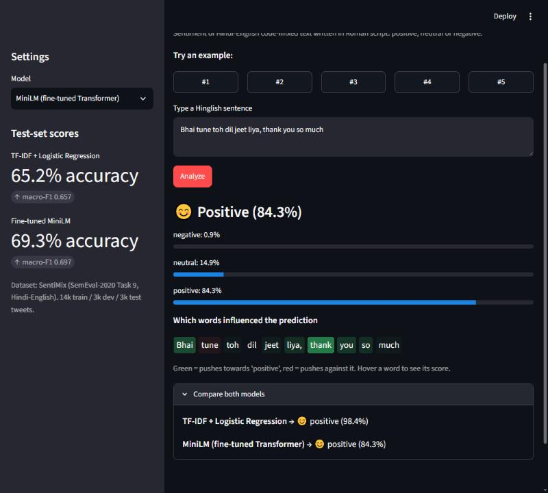
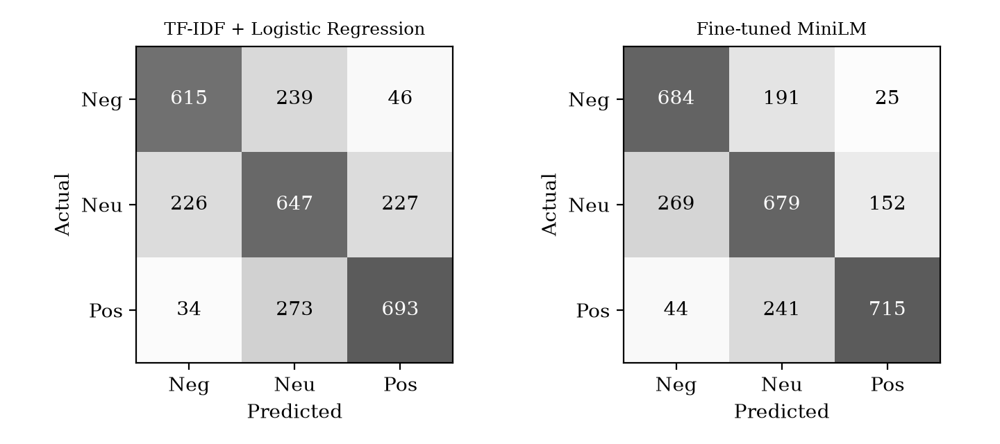
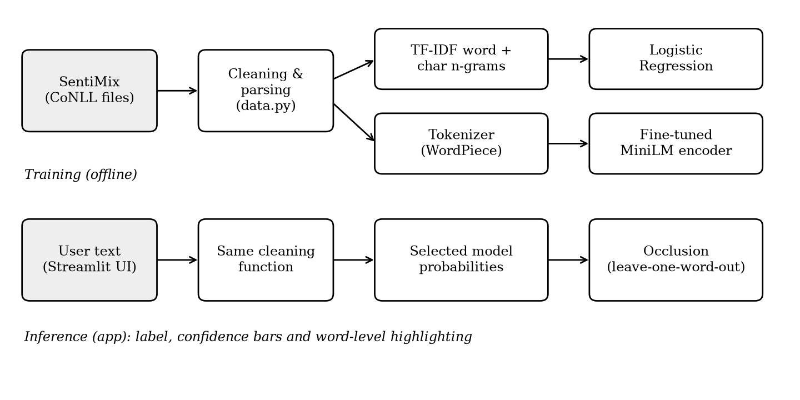

# Hinglish Sentiment Analyzer

Sentiment analysis for **Hinglish**: Hindi and English mixed in one sentence and written in Roman script, such as
*"Movie mast thi yaar, but ending bekar thi"*. The project classifies a text as **negative**, **neutral** or **positive** and
highlights which words pushed the prediction in each direction.

It compares a classical baseline (TF-IDF + Logistic Regression) with a fine-tuned transformer (MiniLM) on the
SemEval-2020 Task 9 (SentiMix) Hindi-English benchmark, and ships as a small Streamlit web app.

<!-- DEMO_LINK: after deploying, add a line here such as: **Live demo:** https://your-app.streamlit.app -->



## Results

Evaluated on the official SentiMix splits (3 classes, 3,000 development tweets and 3,000 test tweets).

| Model | Dev accuracy | Dev macro-F1 | **Test accuracy** | **Test macro-F1** |
|---|---|---|---|---|
| TF-IDF (word + char n-grams) + Logistic Regression | 59.7% | 0.602 | 65.2% | 0.657 |
| Fine-tuned MiniLM (6 layers, 22.7M parameters) | 62.2% | 0.625 | **69.3%** | **0.697** |

- The best epoch of the transformer was chosen on the development set. The test set was used only once, at the end.
- Test F1 per class (transformer): negative 0.721, neutral 0.614, positive 0.756.
- **92.5% of the transformer's errors involve the neutral class**; positive vs. negative swaps are only 7.5% of errors.
  Deciding *whether* a tweet contains an opinion is much harder than deciding which opinion it is.
- For reference, the best SemEval-2020 systems reached about 0.75 F1 using much larger models and GPUs. This model was
  trained on a laptop CPU in about 77 minutes.



## How it works



1. **Cleaning** (`src/data.py`): rebuilds tweets from the token-per-line CoNLL files, removes links, replaces `@mentions` with `@user`.
2. **Baseline** (`src/train_baseline.py`): word 1-2-grams + character 2-5-grams (handles spelling variants such as *kya / kyaa / kia*)
   fed to Logistic Regression. 89,672 features, trains in about a minute.
3. **Transformer** (`src/train_bert.py`): fine-tunes
   [`anuragwagh0/hinglish-minilm`](https://huggingface.co/anuragwagh0/hinglish-minilm) with a 3-way classification head
   (AdamW, lr 5e-5, batch 32, 3 epochs, max length 64).
4. **Explanations** (`src/predict.py`): leave-one-word-out *occlusion*. Each word is removed in turn and the drop in the
   predicted class probability is its score (green = supports the prediction, red = opposes it). It works with both models.
5. **App** (`app.py`): Streamlit UI with model selector, class probabilities, highlighted words and a side-by-side model comparison.

## Quickstart

Python 3.11 or newer is required.

```bash
git clone https://github.com/<your-username>/hinglish-sentiment-analyzer.git
cd hinglish-sentiment-analyzer
python -m venv .venv
# Windows: .venv\Scripts\activate      macOS/Linux: source .venv/bin/activate
pip install -r requirements.txt
streamlit run app.py
```

The trained models are included in `models/`, so nothing needs to be trained to run the app.
The first prediction takes up to a minute because PyTorch and Transformers have to be loaded; later predictions are fast.
On Windows you can also double-click `START_APP.bat`.

## Reproduce the experiments

```bash
python scripts/download_data.py      # downloads SentiMix into data/ (about 5 MB)
python src/train_baseline.py         # about 1 minute on a CPU
python src/train_bert.py --epochs 3 --bs 32 --lr 5e-5    # about 77 minutes on a 4-core CPU
python src/evaluate_test.py          # writes models/test_metrics.json
```

`train_bert.py` accepts `--model`, for example `--model l3cube-pune/hing-bert` to try the Hinglish-specific HingBERT
(about 110M parameters; on a 4-core CPU it needed about 23 s per step, so a GPU is recommended).
The training log of the reported run is in `logs/train_bert.log`.

## Project structure

```
app.py                  Streamlit app
src/data.py             CoNLL parsing and text cleaning
src/train_baseline.py   TF-IDF + Logistic Regression
src/train_bert.py       Transformer fine-tuning
src/predict.py          Model loading, probabilities, occlusion explanations
src/evaluate_test.py    Evaluation on the official test set
scripts/download_data.py  Dataset downloader
models/                 Trained models and metric files
assets/                 Images used in this README
logs/                   Training log
```

## Deploy

**Streamlit Community Cloud** (free): push this repository to GitHub, open <https://share.streamlit.io>, sign in with GitHub,
choose *New app*, select this repository, branch `main` and main file `app.py`, and pick Python 3.12 under *Advanced settings*.
`requirements.txt` already points pip to the CPU build of PyTorch. If the app runs out of memory there, deploy it as a
**Hugging Face Space** (Streamlit SDK) instead; because `model.safetensors` is about 91 MB, track it with Git LFS
(`git lfs track "*.safetensors" "*.joblib"`) before pushing to the Space.

## Limitations

- About 3 in 10 predictions are wrong; the **neutral** class is the weakest.
- The training data is tweets, mostly about Indian politics and celebrities. Strong opinions about products or sports are
  sometimes labelled neutral (for example *"Ye phone bahut kharab hai, paisa barbaad"*).
- The MiniLM tokenizer turns emojis into `[UNK]`, so the transformer cannot use them; the TF-IDF model can.
- Roman-script Hinglish only: Devanagari text, sarcasm and aspect-level sentiment are not handled.
- One training run and one hyper-parameter setting; no significance tests.

## Credits and license

- Code: MIT (see `LICENSE`).
- Dataset: SentiMix, SemEval-2020 Task 9. Patwa et al., *"SemEval-2020 Task 9: Overview of Sentiment Analysis of Code-Mixed Tweets"*, SemEval 2020.
  The data is not redistributed here; the Hugging Face mirror used by the download script lists the OpenRAIL license.
- Base model: [`anuragwagh0/hinglish-minilm`](https://huggingface.co/anuragwagh0/hinglish-minilm), derived from
  `sentence-transformers/all-MiniLM-L6-v2` (Apache-2.0). Its model card does not state a license, so the fine-tuned weights in
  `models/transformer/` are provided for educational and portfolio use; check the upstream terms before any commercial use.
- Built with scikit-learn, PyTorch, Hugging Face Transformers and Streamlit.

Author: Akshay Kumar Mishra (MCA, BIT Mesra), built as an NLP course project.
